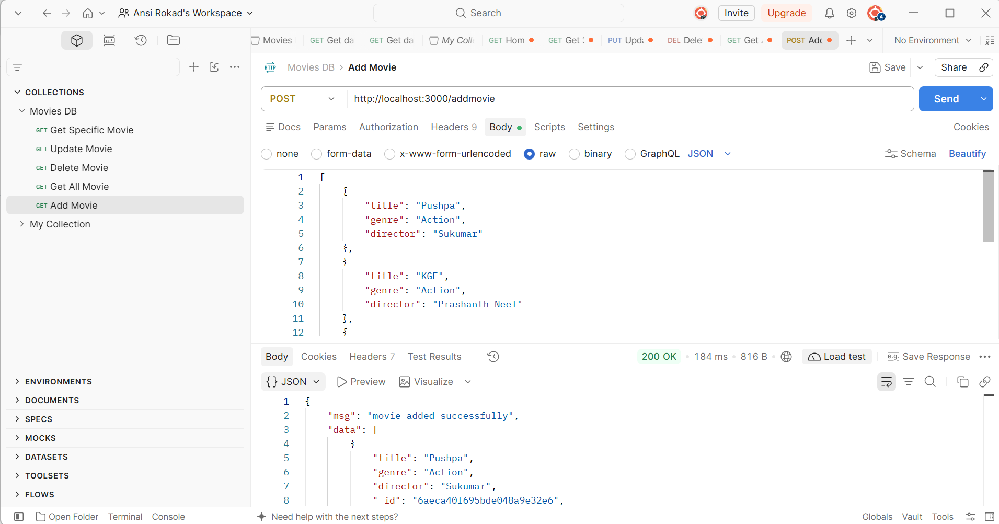
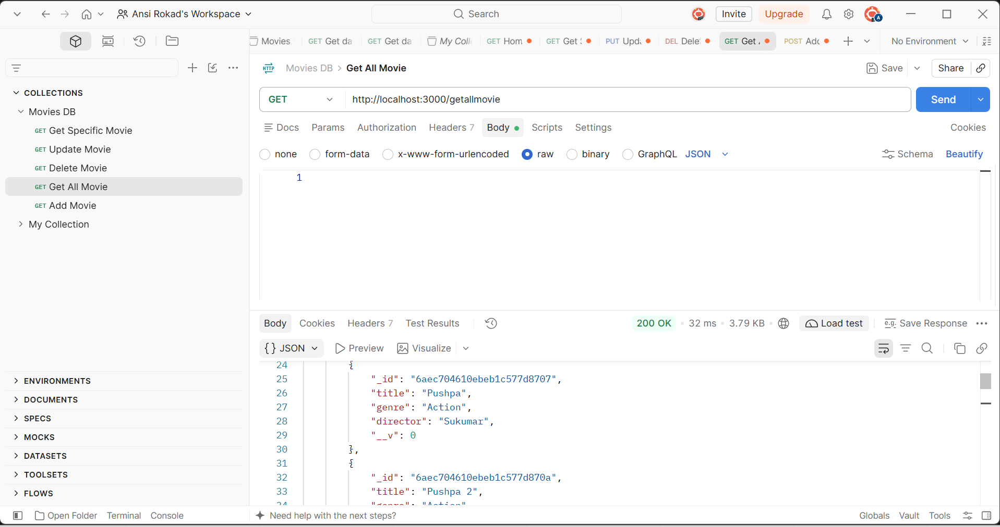
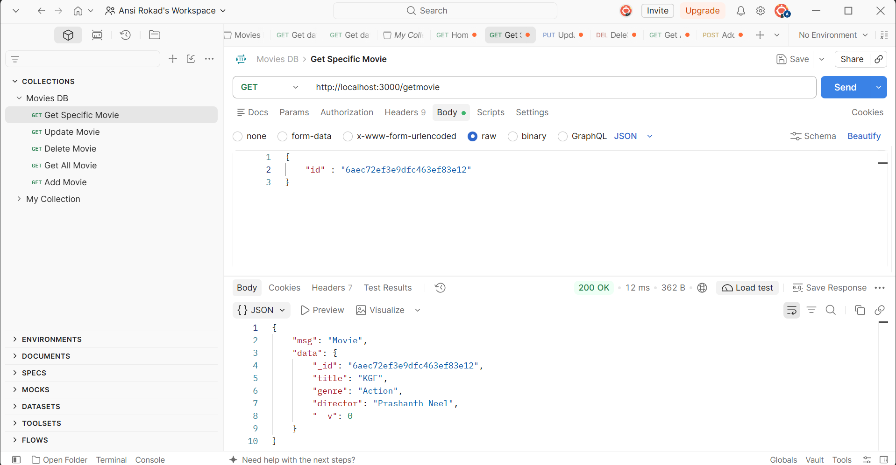
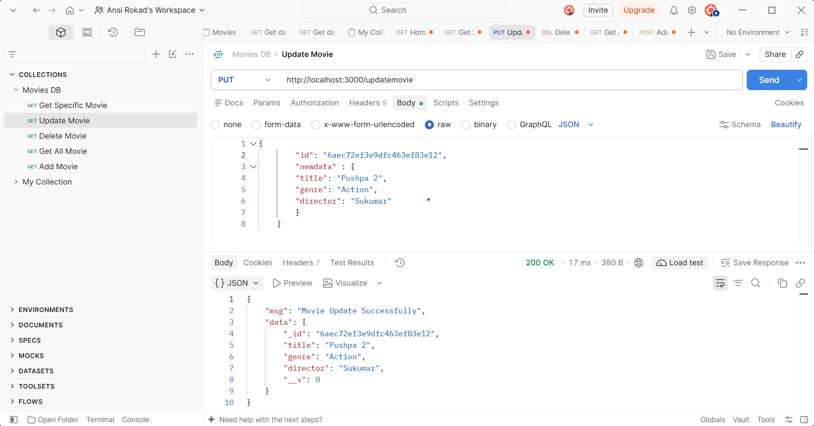
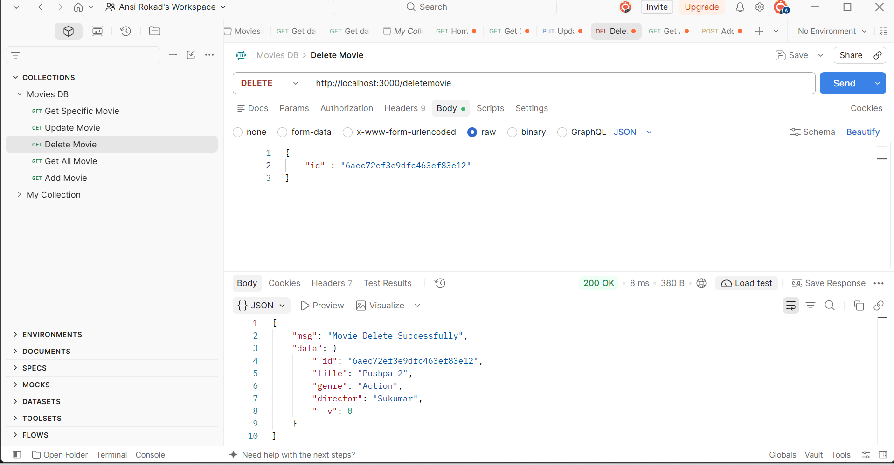

# 🎬 Movies Management System

A RESTful API application developed using **Node.js, Express.js, MongoDB, and Mongoose** to manage movie records efficiently. This project provides complete CRUD functionality, allowing users to create, retrieve, update, and delete movie information.

## 🚀 Tech Stack

| Technology | Purpose |
|---|---|
| Node.js | JavaScript Runtime |
| Express.js | Backend Framework |
| MongoDB | NoSQL Database |
| Mongoose | MongoDB ODM |
| Postman | API Testing |

## ✨ Key Features

- **Add Movies:** Create and store new movie records.
- **View All Movies:** Retrieve all movies from the database.
- **Get Movie by ID:** Find a specific movie using its unique MongoDB ID.
- **Update Movies:** Modify existing movie details.
- **Delete Movies:** Remove movie records from the database.
- **Database Integration:** Connect and manage data using MongoDB and Mongoose.
- **REST API:** Handle HTTP requests using Express.js.

## 📂 Project Structure

```text
Movies-Management/
│
├── node_modules/
├── app.js
├── package.json
├── package-lock.json
└── README.md
```

## ⚙️ Installation & Setup

**Step 1: Clone Repository**

```bash
git clone <your-repository-url>
```

**Step 2: Navigate to Project Folder**

```bash
cd Movies-Management
```

**Step 3: Install Dependencies**

```bash
npm install express mongoose
```

**Step 4: Start MongoDB**

Make sure MongoDB is installed and running on your system.

**Step 5: Run the Application**

```bash
node app.js
```

**Server URL:**

```text
http://localhost:3000
```

## 🔗 API Documentation

Base URL: `http://localhost:3000`

| Method | Endpoint | Description |
|---|---|---|
| GET | `/` | Home Page |
| POST | `/addmovie` | Add a New Movie |
| GET | `/getallmovie` | Get All Movies |
| GET | `/getmovie` | Get Movie by ID |
| PUT | `/updatemovie` | Update Movie |
| DELETE | `/deletemovie` | Delete Movie |

## 📝 Sample Movie Data

```json
{
    "title": "Pushpa",
    "genre": "Action",
    "director": "Sukumar"
}
```

## 🗄️ Database Configuration

**Database:** `moviesDB`

**Collection:** `movies`

**Movie Schema:**

| Field | Type |
|---|---|
| title | String |
| genre | String |
| director | String |

**MongoDB Connection:**

```js
mongoose.connect("mongodb://127.0.0.1:27017/moviesDB");
```

## 🧪 API Testing

All API endpoints are tested using **Postman** to verify CRUD operations and database responses.

## 🎯 Project Objective

The main objective of this project is to understand backend development, RESTful API architecture, MongoDB database connectivity, and CRUD operations using Node.js and Express.js.

## 📷 Screenshots

### Add Movie


### Get All Movie


### Get Specific Movie


### Get Updet Movie


### Delete Movie



## 🔗 Video Link

https://drive.google.com/file/d/1iGDK5RnBF8-3cQkNgkRUFcyJc9BROUwO/view?usp=sharing